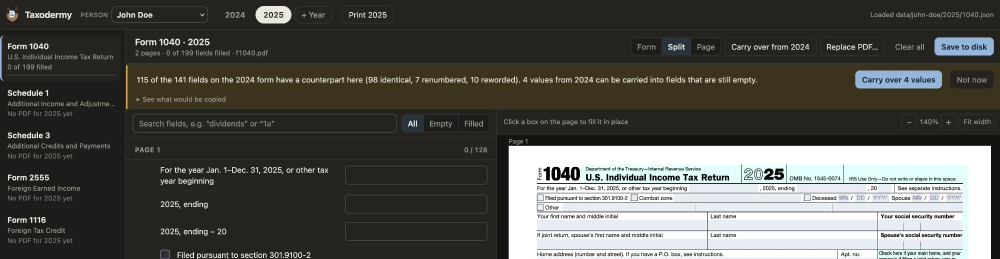

# Taxodermy

*Stuffing last year's numbers into this year's forms.*

Every spring the IRS hands you the same forms as last year, with a few lines renumbered just to keep you on your toes. Taxodermy opens the official fillable PDFs as tidy forms in your browser, then carries last year's answers over into this year's forms. It matches fields by the label printed next to each box, not by internal field names that change every year. Keep returns for several people side by side, convert Swiss francs at the IRS yearly rate, and save the filled PDFs ready to print and sign. It does not do your taxes: you still decide every number, it just spares you the retyping.



**Made with Americans abroad in mind.** The forms that come set up are the usual expat set: Form 1040 with Schedules 1 and 3, Form 2555 (Foreign Earned Income), Form 1116 (Foreign Tax Credit) and Form 8938 (Foreign Financial Assets). That's only a starting point. Click **+ Add a form** to add any other IRS form, and remove the ones you don't need, so the list fits your own return.

> **Everything stays on your computer.** There is no cloud, no account, no tracking and no database. The app is a tiny server that listens only on your own machine (127.0.0.1), and your entries are plain files in the `data` folder. Nothing is ever uploaded or sent anywhere: the app makes no outside requests. The only time anything touches the internet is when you click a link to irs.gov yourself.

## Start

### Download the app (Windows and Mac)

Nothing to install. From the [latest release](https://github.com/bendeca/taxodermy/releases/latest), download the zip for your computer:

| Computer | Download |
| --- | --- |
| Windows | `taxodermy-windows.zip` |
| Mac with Apple chip (M1 or newer) | `taxodermy-macos-apple-silicon.zip` |
| Mac with Intel chip | `taxodermy-macos-intel.zip` |

Not sure which Mac you have? Apple menu → About This Mac: “Chip: Apple M…” means Apple Silicon, “Processor: Intel…” means Intel.

Unzip it somewhere you'll find it again, e.g. your Documents folder, and double-click **Taxodermy** inside the `taxodermy` folder. A small window opens (that is the app's server, keep it open while you work) and the app opens in your browser. Close that window to quit. Your entries are saved in the `data` folder right next to the program.

The program isn't signed by a paid Apple or Microsoft developer account, so the first start shows a warning:

- **Mac:** “Apple could not verify Taxodermy…”. Click **Done**, open **System Settings → Privacy & Security**, scroll down and click **Open Anyway** next to Taxodermy, then confirm. On older macOS versions, right-click Taxodermy, choose **Open** and confirm instead. You only do this once.
- **Windows:** “Windows protected your PC”. Click **More info**, then **Run anyway**.

**Updating:** unzip the new version, then move your `data` folder from the old `taxodermy` folder into the new one, replacing the `data` folder that comes with it.

### Or run it from the source code

If you have Python 3 or Node installed:

```
git clone https://github.com/bendeca/taxodermy.git
cd taxodermy
python3 server.py        # or: node server.js
```

Then open http://127.0.0.1:8040/ (it opens by itself). Options, for the downloaded program too: `--port 8041`, `--data /path/to/folder`, `--no-open`.

Opening `index.html` directly does not work: a browser page cannot write files, which is all the small server is for. It listens on 127.0.0.1 only.

### Publishing a new version

Push a version tag, e.g. `git tag v1.0.0 && git push origin v1.0.0`, or open the **Release** workflow on the Actions tab, click **Run workflow** and enter the version. The workflow on GitHub builds the three zips and publishes them as a release. It compiles `server.js` with [Bun](https://bun.sh) into a single program; the app files sit next to it.

## Use

1. Pick the **person** at the top left. "Add a person…" in the same menu creates another one; each person has their own folder.
2. Pick the tax year (`+ Year` adds one for the selected person).
3. Each form has its own section on the left. Add the blank fillable PDF for that year with **Choose PDF**, or drop several PDFs anywhere and they are sorted into the right sections. If another person already has that year's blank forms, you can copy them with one click; a PDF that already contains someone's entries is never copied.
4. Type in the generated form or directly on the page. Every change is saved straight away.
5. When a form also exists in an earlier year of the same person, **Carry over from <year>** copies last year's values into matching fields that are still empty, and lists the values that found no match. Carried values are marked "from <year>" until you confirm or change them.
6. **Save to disk** writes your entries into a copy of the PDF in the same folder (`1040-filled.pdf` next to `1040.pdf`). If you change entries afterwards, the app tells you the copy on disk is out of date until you save again.
7. **Extra copies of a page.** Form 8938 takes one page 2 per account or asset. In its Page 2 section, **+ Add a copy of this page** gives you the same page again with its own entries; add as many as you need. In the saved PDF each copy follows page 2 with its entries printed on it.
8. **Print <year>** (top bar) puts every form of the selected person and year that has entries into one document, in the order of the sections, and opens the print dialog. It uses your current entries; nothing is written to disk.
9. **+ Add a form** (below the forms) adds a section for another IRS form, e.g. Schedule 2: enter its name, the title printed on the form and, optionally, the IRS file name (`f1040s2`). It shows up for every person and year. A section that nobody has a PDF or entries for yet has **Remove this section**.
10. **Exchange rate** (below the forms) holds the IRS yearly average rate for the Swiss franc, one number per tax year, shared by everyone. The converter in the sidebar turns CHF amounts into U.S. dollars at the selected year's rate.

## Starting from a return you already filed

No need to retype last year. If you still have last year's return as a filled-in PDF, Taxodermy can read the values in it and carry them over into this year's forms:

1. Select last year (`+ Year` adds it if it isn't there yet) and add your filled-in PDFs there, just like blank forms: drop them anywhere or use **Choose PDF**. Your entries show up in the form, ready to check or correct.
2. Switch to this year and add the blank forms for this year.
3. Open a form and click **Carry over from <last year>**. The values from the filled PDF, plus anything you changed in the app, go into the matching fields of this year's form.

This works with PDFs whose form fields can still be clicked and typed into, e.g. the IRS forms filled in with Adobe Reader, Preview or Taxodermy itself. If the values were flattened into the page (common when tax software or a "print to PDF" produced the file) or the PDF is a scan, there are no fields to read the values from.

## Files

```
index.html
assets/                  app code, styles, PDF engine (pdf.js)
server.py  server.js     the same tiny file server, twice (server.js is also what the downloadable program is built from)
data/
  forms.json             the list of form sections (edit to add e.g. Schedule 2)
  people.json            the people and their display names
  rates.json             IRS yearly average CHF rate per tax year, for everyone
  ada-lovelace/          one folder per person
    2024/
      1040.pdf           the blank PDF added for 2024
      1040.json          what was entered: values, readable labels, counts
      1040-filled.pdf    the filled PDF, written by Save to disk
      2555.pdf  2555.json  …
    2025/
      …
  byron-lovelace/
    …
```

Back up or move your data by copying the `data` folder. It contains tax details unencrypted.

Renaming a person in the app changes the display name in `people.json`; the folder keeps its name.

**Coming from a version without people:** start the new `server.py` / `server.js`. The app finds the year folders directly under `data/`, asks whose returns they are, and moves them into that person's folder. Per-year `rates.json` files are merged into `data/rates.json`.

## How carry-over decides what matches

Internal PDF field names are renumbered by the IRS whenever a line is added, so they are not trusted. Fields are paired by what is printed next to them, in three steps:

1. **Identical**: same kind (text, tick box, list), same line number, same label.
2. **Renumbered**: same label, but the line got a letter (11 became 11a) or the surrounding question was reworded.
3. **Reworded**: same line, wording changed a little ("Add lines 12 and 13" became "Add lines 12e, 13a, and 13b"), or an unnumbered box whose text was only extended.

Years in a label are compared relative to the tax year. Anything ambiguous is left alone, for example a box that was split into two.

The values taken from the earlier year are what you typed here plus anything already filled in inside that year's PDF, so you can also add last year's completed return as the PDF. Only fields that are still empty are filled. Before copying, the app shows what would be copied (non-identical matches are marked) and which of last year's values found no matching field, so you can copy those by hand.

Labels are read from the text printed around each box, so check carried-over values before filing.

## Adding a form

Use **+ Add a form** in the app, or add an entry to `data/forms.json` by hand:

```json
{ "id": "1040-schedule-2", "name": "Schedule 2", "title": "Additional Taxes",
  "irsFile": "f1040s2", "detect": "Additional Taxes" }
```

`id` becomes the file name, `irsFile` is the IRS download name used to recognise dropped files, `detect` is text from the form's title. Add `"repeatPages": [2]` to let page 2 of a form be added several times, as Form 8938 does.
